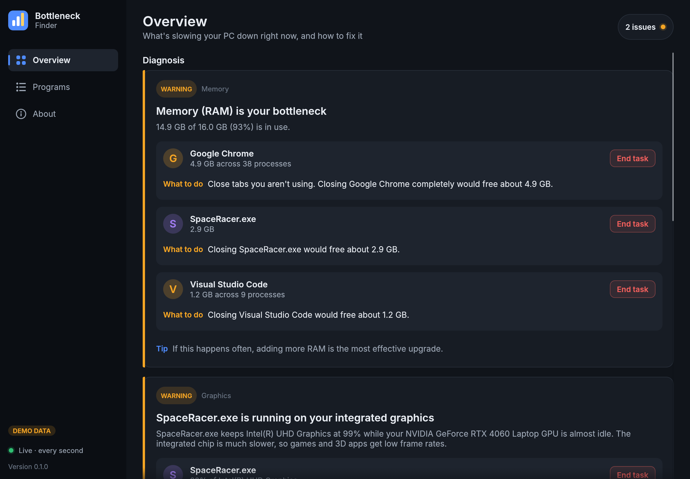
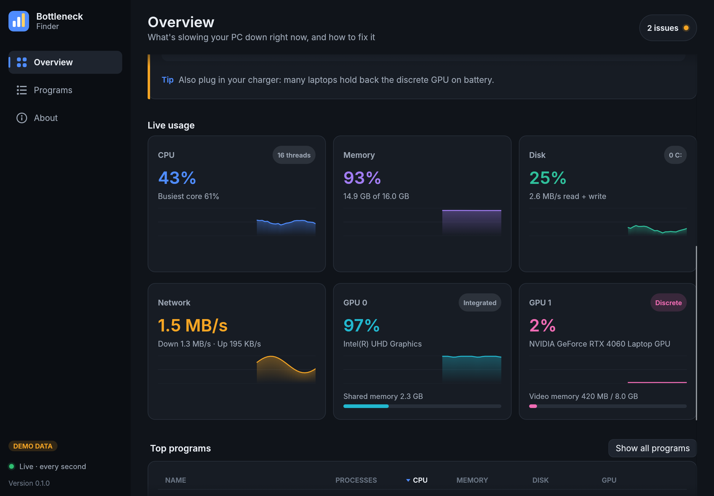
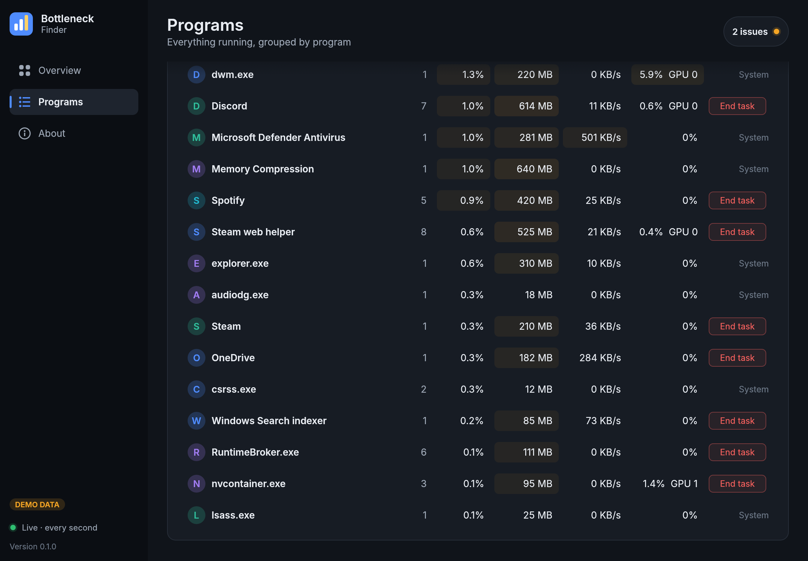

<p align="center"></p>

# PC Bottleneck Finder

A small, fast Windows app that tells you **what is slowing your PC down, which program is causing it, and what to do about it**, in plain language. It supports laptops with two graphics cards.



<sub>Screenshots use the app's built-in demo data (`--demo`).</sub>

## Download

Get `pc-bottleneck-finder.exe` from the [Releases](../../releases) page, or from the latest [Build](../../actions/workflows/build.yml) run (under *Artifacts*).
It's a single 6 MB file: no installer and no runtime needed. Just double-click it.

> Windows SmartScreen may warn about an unknown publisher because the app isn't code-signed. Click **More info → Run anyway**.

## What it detects

| Bottleneck | How it's detected | Example advice |
|---|---|---|
| **Memory** | RAM ≥ 90% used, or ≥ 85% while Windows is paging to disk | "Close tabs you aren't using. Closing Google Chrome completely would free about 4.9 GB." |
| **CPU** | Total CPU ≥ 85% | "A tab or extension is busy. Press Shift+Esc in Microsoft Edge to see which one." |
| **Disk** | The busiest physical disk is ≥ 90% busy | "Windows is indexing your files for search. It usually finishes on its own." |
| **Single-threaded program** | One program keeps a single core at 100% while the CPU overall is mostly idle | "This is a limit of the program, not a problem with your PC." |
| **Graphics card** | A GPU is ≥ 90% busy | "Lowering its resolution or graphics quality will reduce the load." |
| **Video memory** | A graphics card's own memory is ≥ 90% full | "Lower the texture quality, or close other programs that use the graphics card." |
| **Game on the wrong GPU** | A laptop's integrated GPU is busy with a 3D app while the discrete GPU sits idle | "Open Settings > System > Display > Graphics, choose the game, set it to High performance." |

- A problem is only reported when it lasts for **most of the last 15 seconds**, so short spikes like opening an app are ignored.
- The app knows common Windows processes, such as Defender, Windows Update, the search indexer and Memory Compression, and explains them instead of blaming them.
- When memory pressure causes disk activity (paging), the disk finding says so.
- **It never offers to end Windows system processes.** Ending any other program always asks for confirmation first.

## Live usage, including every GPU



Each GPU gets its own card. Integrated and discrete GPUs are labelled, and each card shows the GPU's busiest engine and its memory use. The numbers come from the same Windows counters Task Manager uses.

## Programs



All processes of a program (e.g. 38 × `chrome.exe`) are grouped into one row. You can sort by CPU, memory, disk or GPU, search by name, and end a program with one click.

## Why Rust

A monitoring tool shouldn't become a bottleneck itself. The app is written in Rust and compiles to a single native `.exe`:

- Measuring runs on a background thread once per second.
- The window only redraws when new data arrives or you interact with it.
- No runtime or garbage collector.

It uses the Windows font (Segoe UI) installed on your PC rather than bundling one.

## How it works

| File | Role |
|---|---|
| `src/sampler.rs` | Reads CPU, memory, network and per-process usage every second ([`sysinfo`](https://crates.io/crates/sysinfo)) |
| `src/platform/windows.rs` | Windows performance counters (disk busy %, paging, GPU engines and memory) and DXGI (GPU names and memory sizes) |
| `src/gpu.rs` | Turns GPU counter readings into per-GPU and per-program usage, and tells integrated from discrete GPUs |
| `src/diagnosis.rs` | The rules that turn measurements into findings, culprits and advice |
| `src/knowledge.rs` | Friendly names for common programs, and which processes must never be ended |
| `src/ui/` | The interface ([`egui`](https://github.com/emilk/egui)), all custom drawn |
| `src/demo.rs` | Simulated data for `--demo` |

## Building from source

Install [Rust](https://rustup.rs), then:

```bash
cargo test
cargo build --release
```

The app is in `target/release/pc-bottleneck-finder.exe`. Run it with `--demo` to see simulated data.

Every push is built and tested on Windows by GitHub Actions. Pushing a tag like `v0.2.0` also publishes a release with the `.exe` attached.

## Notes

- Some processes can only be ended when the app runs **as administrator** (right-click → *Run as administrator*).
- Network usage is shown for the whole PC. Per-program network usage isn't available yet.
- The rules are heuristics. They catch the common cases reliably, but they're a well-informed guess, not a guarantee.

## Roadmap

See [ROADMAP.md](ROADMAP.md).
